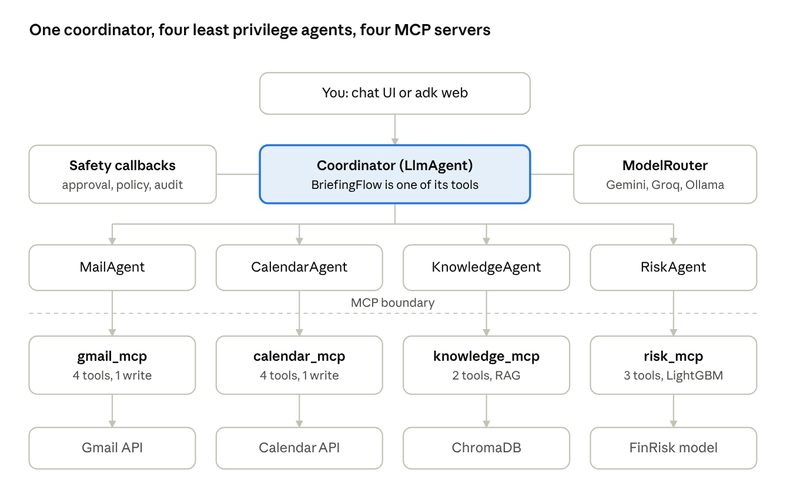

# Atlas

**An MCP-based multi-agent chief of staff.** Ask "what's going on today?" and a Google ADK
coordinator queries your mail, calendar, documents and a credit risk model in parallel,
then answers with every claim cited to its source.

> Status: in active development since 25 October 2026. Coming soon.

## What it shows

- **MCP from scratch:** four MCP servers (Gmail, Calendar, Knowledge/RAG, Risk) exposing
  tools, resources and prompts over streamable HTTP.
- **Multi-agent orchestration:** a deterministic briefing workflow (parallel fan-out, then
  synthesis) plus an LLM-routed coordinator for open questions.
- **Least privilege by design:** each specialist agent can reach only its own server.
- **Enterprise-grade controls:** human approval before any write, append-only audit log,
  PII masking before text reaches a model, prompt-injection defences.
- **Model routing:** Gemini on the free tier, with automatic fallback to Groq and local Ollama.
- **Measured, not claimed:** five eval sets (routing, grounding, safety, injection,
  briefing) tracked in MLflow.

## Architecture

Full design: [docs/LLD.md](docs/LLD.md)

## Stack

Google ADK · MCP Python SDK · LiteLLM · Gemini / Groq / Ollama · Gmail and Calendar APIs ·
ChromaDB · LightGBM · Microsoft Presidio · SQLite · MLflow · FastAPI · React · Docker · GitHub Actions

## Data and privacy

Atlas runs only against a dedicated demo Google account seeded with fictional mail and
meetings. No real personal data is used anywhere in this project.

## Roadmap

- [ ] Phase 1: Calendar MCP server + first ADK agent
- [ ] Phase 2: Gmail + Knowledge servers, orchestrator, model router
- [ ] Phase 3: Risk server, approval gate, audit log, PII masking
- [ ] Phase 4: evals, Docker Compose, UI, demo video
